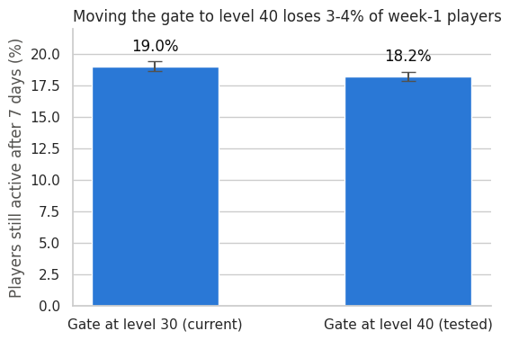

# Should we move the first gate? An end-to-end A/B test

## Answer
**No. Keep the gate at level 30.** Moving it to level 40 lowered 7-day retention from 19.0% to 18.2% (-0.8 pp, 95% CI -1.3 to -0.3 pp), about 4% fewer players still active after a week. The effect is statistically significant (p = 0.002) and a bootstrap confirms it. The groups are slightly unbalanced; a conservative check that removes the extra players still finds a significant drop (-0.6 pp).

**In plain words:**
- With the gate at level 40, about 4% fewer players come back a week later (at least 3% under the conservative check).
- For every 100,000 new players, that is roughly 800 fewer still playing after a week, and fewer potential buyers.
- The direction of the result does not change under any of the checks, including one for a possible problem in how players were split into groups.

> This is a retrospective analysis of a public dataset. The design section shows how I would have set up the test before launch.

## Business question
Cookie Cats is a free-to-play mobile game. At certain levels a "gate" forces players to wait or pay before they can continue. The team tested moving the first gate from level 30 to level 40. Should the game ship the change?

This is the same decision a freemium app or SaaS product faces when it chooses where to place a paywall or a usage limit.



## Experiment design (written as a pre-registration)
- **H0:** 7-day retention is the same with the gate at level 30 and at level 40. **H1:** it is different (two-sided: the change could help or hurt).
- **Primary metric:** 7-day retention, because it measures whether players stay, which drives long-term revenue. Most players do not reach level 30 on day one, so the gate barely affects 1-day retention.
- **Secondary metric:** 1-day retention · **Guardrail:** game rounds played.
- **α / power:** 0.05 / 0.80 · **Minimum detectable effect:** 1 pp. With a baseline of about 19%, losing 1 pp means about 5% fewer retained players, a meaningful revenue loss for a freemium game.
- **Required sample per group:** 23,664 · **Actual:** 44,699 in the smaller group, enough to detect effects down to 0.73 pp.

## Data quality checks
- 90,189 players, no missing values, no duplicated players.
- **Outlier:** one player logged 49,854 rounds in their first 14 days (about 150 rounds per hour, non-stop); the next highest is 2,961. I treated it as a bot or logging error and dropped it (1 row). Players with 0 rounds stay in: they are real users who installed and left.
- **Sample ratio mismatch (SRM):** the split is 50.4% / 49.6% (chi-square = 6.90, p = 0.009). It passes the usual SRM threshold (p < 0.001) but is borderline, so I flag it as a limitation.

## Results
| Metric | gate_30 | gate_40 | Difference | 95% CI | p-value |
|---|---|---|---|---|---|
| 7-day retention (primary) | 19.02% | 18.20% | **-0.82 pp** | -1.33 to -0.31 pp | **0.0016** |
| 1-day retention | 44.82% | 44.23% | -0.59 pp | -1.24 to +0.06 pp | 0.074 |
| Game rounds (guardrail) | mean 51.3, median 17 | mean 51.3, median 16 | no change | | 0.051 (Mann-Whitney) |

**SQL cross-check (DuckDB):** the same group sizes and retention rates, computed in SQL as they would be in a data warehouse, match the pandas results exactly.

```sql
SELECT version,
       COUNT(*)                                       AS players,
       ROUND(100 * AVG(CAST(retention_1 AS INT)), 2)  AS retention_1_pct,
       ROUND(100 * AVG(CAST(retention_7 AS INT)), 2)  AS retention_7_pct,
       MEDIAN(sum_gamerounds)                         AS median_rounds
FROM df_clean
GROUP BY version
ORDER BY version;
```

**Bootstrap (2,000 resamples):** the 95% interval for the 7-day retention difference is -1.31 to -0.33 pp, almost identical to the z-test, and gate_30 wins in 99.9% of resamples. The result does not depend on the normal approximation.

### Where does the effect come from? (exploratory)
I split players by engagement: 30+ rounds (likely reached the gate) vs. fewer.

| Segment | gate_30 | gate_40 | Difference | p-value | Players (30 / 40) |
|---|---|---|---|---|---|
| 30+ rounds | 43.87% | 43.00% | -0.87 pp | 0.11 | 16,655 / 16,613 |
| Under 30 rounds | 4.26% | 3.93% | -0.33 pp | 0.049 | 28,044 / **28,876** |

- gate_40 retains less in both segments.
- **The assignment imbalance sits in low-engagement players:** gate_40 has 832 more players with fewer than 30 rounds than gate_30 (and 42 fewer with 30+ rounds). These players retain at about 4%, so if the extra ones came from an assignment error, they push gate_40's retention down on their own.
- Rounds are counted over each player's first 14 days, after assignment and partly after the day-7 check, so this split is descriptive, not causal.

**Sensitivity:** removing the 790 extra players from gate_40 shrinks the drop from -0.82 to **-0.57 pp**, still significant (p = 0.030). This is a robustness check under an assumption, not a corrected estimate: it assumes the extra players are low-engagement players retained at that segment's rate, and engagement (rounds played) is measured after assignment. What it shows is that the drop stays negative and significant even under an assumption that works against it. The headline estimate remains the measured -0.82 pp.

## Decision memo
- **Recommendation:** keep the gate at level 30. Do not ship the move to level 40.
- **Why:** 7-day retention drops by 0.82 pp (about 4% fewer players retained after a week). The z-test and the bootstrap agree, and the drop remains significant in the conservative check. Players in gate_40 also do not play more rounds, so engagement does not make up for the loss.
- **Risks and limits:** the SRM is borderline and concentrated in low-engagement players, so I would audit the assignment logs before acting in a real setting. The data only tracks each player's first 14 days and has no spending data, so the revenue impact is estimated through retention, not measured. Only 7-day retention was the pre-specified decision metric; the other tests are supporting evidence.
- **Next test:** fix or audit the assignment, then try an earlier or softer gate (for example a waiting time instead of a hard block) and track revenue per player alongside 7-day retention.
- **Hypothesis (not tested here):** an earlier break may slow players down and keep the game from getting boring, a form of hedonic adaptation from behavioral economics. A follow-up test with a softer gate would help tell this apart from other explanations.

## How I used AI
I directed the analysis; Claude Code handled the execution. I designed the test and made every analytical decision (the primary metric, the minimum detectable effect, the outlier rule, how to treat the borderline SRM and the final recommendation) and set the checks the results had to pass. Claude Code wrote and ran the code and drafted the text, which I reviewed and edited.

- **Checks:** the notebook re-run from scratch, the key numbers reproduced with two independent methods (SQL vs. pandas, z-test vs. bootstrap) and every variable definition checked against the dataset documentation.
- **What they caught:** the rounds column covers a player's first 14 days, not one week, which changed the outlier reasoning and the caveat on the segment analysis.

## Files
- [`ab_test_cookie_cats.ipynb`](ab_test_cookie_cats.ipynb): the full analysis, step by step.
- `summary_chart.png`: the summary chart shown above.

**To run it:** open the notebook in Google Colab, download `cookie_cats.csv` from the Kaggle link below, upload it to the Colab session and run all cells.

## Tools
Python (pandas, NumPy, SciPy, statsmodels, seaborn, matplotlib) · SQL (DuckDB) · Google Colab

## Data
[Mobile Games A/B Testing – Cookie Cats](https://www.kaggle.com/datasets/yufengsui/mobile-games-ab-testing) (Kaggle), 90,189 players randomly assigned to gate_30 or gate_40.
